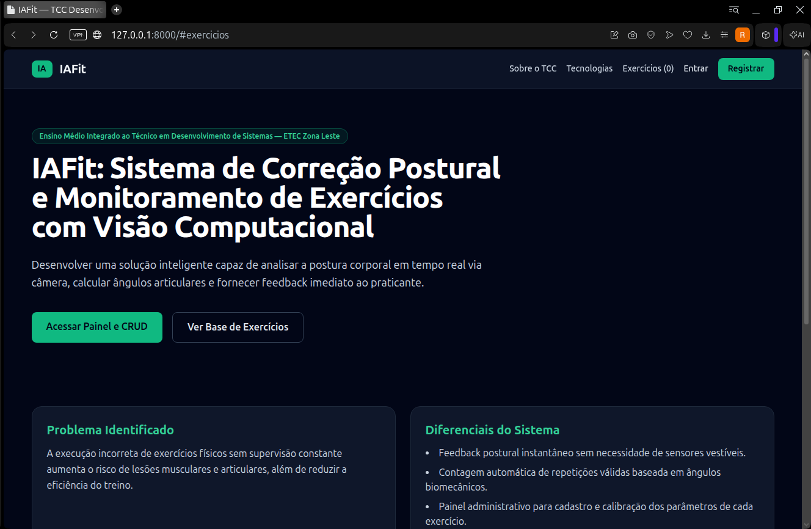
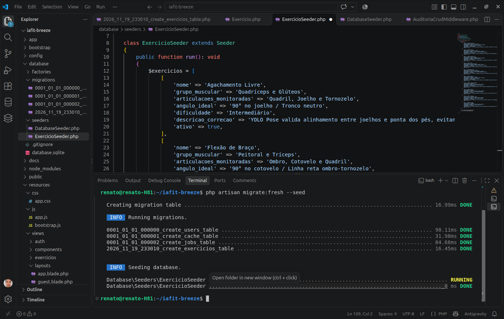
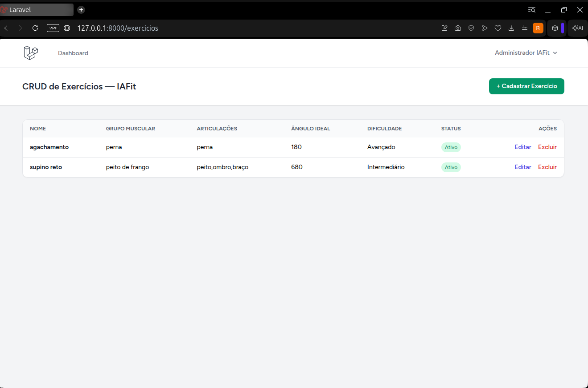
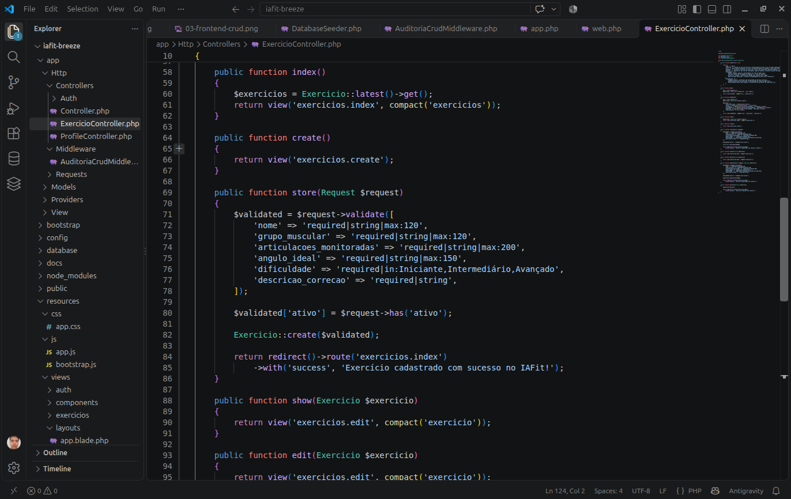

# 🏋️‍♂️ IAFit — Sistema de Correção Postural com Visão Computacional

> **Atividade:** Laravel Breeze - CRUD com Integração ao TCC  
> **Curso:** Ensino Médio Integrado al Técnico em Desenvolvimento de Sistemas — ETEC Zona Leste  
> **Tecnologias principais:** Laravel 11, Laravel Breeze, Tailwind CSS, SQLite, PHP, Node.js e Composer.

---

## 📌 Visão Geral do Projeto

O **IAFit** é um sistema inteligente projetado para auxiliar praticantes de exercícios físicos na execução correta de seus treinos, utilizando visão computacional (Python, OpenCV e YOLO Pose) para monitorar posturas corporais e medir ângulos articulares em tempo real.

Esta aplicação web desenvolvida em **Laravel 11** atua como a plataforma administrativa e portal do usuário do IAFit. Ela permite o gerenciamento completo (CRUD) do catálogo de exercícios monitorados, cadastro de regras de ângulos ideais, correções posturais e controle de acesso via autenticação segura.

---

## ✅ Requisitos Cumpridos na Entrega

- [x] **Ambiente configurado:** Laravel 11, Composer, Node.js e Banco de Dados SQLite.
- [x] **Autenticação Laravel Breeze:** Rotas e telas de Login, Registro, Recuperação de Senha e Dashboard.
- [x] **Estilização com Tailwind CSS:** Interface moderna, responsiva e alinhada ao tema visual do IAFit.
- [x] **Rota Fallback (`Route::fallback`):** Redirecionamento customizado amigável (página 404 personalizada) para qualquer URL inexistente.
- [x] **Middleware Personalizado (`AuditoriaCrudMiddleware`):** Controle de segurança e log de auditoria para todas as operações do CRUD de exercícios.
- [x] **Seeders e Migrations:** População automática do banco de dados contendo **10 registros completos** de exercícios com parâmetros biomecânicos e 1 usuário administrador.
- [x] **Integração Front-End & Back-End:** Apresentação integral dos dados do TCC tanto na página inicial pública (`/`) quanto no Painel de Controle (`/dashboard`).

---

## 🛠️ Tecnologias e Ferramentas

- **Back-End:** PHP 8.2+, Laravel 11.x, Eloquent ORM
- **Front-End:** Blade Templating Engine, Tailwind CSS, Vite, Alpine.js (via Breeze)
- **Banco de Dados:** SQLite
- **Segurança & Middleware:** Laravel Breeze (Guard Auth) + `AuditoriaCrudMiddleware`
- **Controle de Versão:** Git & GitHub

---

## 🚀 Como Executar o Projeto Localmente

### Pré-requisitos
- PHP >= 8.2 (com extensão `pdo_sqlite` ativada)
- Composer
- Node.js & NPM

### Passo a Passo

1. **Clonar o repositório:**
   ```bash
   git clone https://github.com/SEU-USUARIO/iafit-breeze.git
   cd iafit-breeze
   ```

2. **Instalar as dependências do PHP (Composer):**
   ```bash
   composer install
   ```

3. **Configurar as variáveis de ambiente:**
   ```bash
   cp .env.example .env
   php artisan key:generate
   ```
   *Nota: O Laravel 11 já utiliza SQLite por padrão (`DB_CONNECTION=sqlite`).*

4. **Criar o arquivo do banco SQLite e executar as Migrations e Seeders:**
   ```bash
   touch database/database.sqlite
   php artisan migrate:fresh --seed
   ```

5. **Instalar e compilar os ativos do Front-End (Tailwind CSS):**
   ```bash
   npm install
   npm run build
   ```

6. **Iniciar o servidor local de desenvolvimento:**
   ```bash
   php artisan serve
   ```

7. **Acessar a aplicação:**
   - **Página Inicial:** `http://127.0.0.1:8000`
   - **Login (Administrador padrão criado pelo Seeder):**
     - **E-mail:** `admin@iafit.com`
     - **Senha:** `12345678`

---

## 📸 Evidências de Funcionamento (Prints)

> *Copie suas capturas de tela para a pasta `docs/prints/` do repositório utilizando os nomes indicados abaixo:*

### 1. Site Funcionando em Localhost
Apresentação da Landing Page pública contendo a descrição completa do TCC IAFit, objetivos, stack tecnológica e a listagem dinâmica de exercícios cadastrados.



---

### 2. Banco de Dados (Migrations e Seeders)
Execução do comando `php artisan migrate:fresh --seed` no terminal, demonstrando a criação da tabela `exercicios` e o povoamento automático com **10 registros**.



---

### 3. Front-End (Operações CRUD)
Interface do usuário exibindo o painel de controle (`/dashboard`), a tabela de listagem de exercícios (`/exercicios`), formulário de criação (`/exercicios/create`) e edição (`/exercicios/{id}/edit`).



---

### 4. Back-End (Rotas, Controller, Middleware e Fallback)
Código-fonte das rotas no `routes/web.php`, validação do `ExercicioController.php`, logs gravados pelo `AuditoriaCrudMiddleware` e demonstração do tratamento de rotas inexistentes com `Route::fallback`.



---

## 📂 Estrutura de Arquivos Principais

```text
iafit-breeze/
├── app/
│   ├── Http/
│   │   ├── Controllers/
│   │   │   └── ExercicioController.php   # Lógica do CRUD e Dados do TCC
│   │   └── Middleware/
│   │       └── AuditoriaCrudMiddleware.php # Middleware de segurança e log
│   └── Models/
│       └── Exercicio.php                 # Model Eloquent
├── database/
│   ├── migrations/
│   │   └── xxxx_create_exercicios_table.php # Tabela de Exercícios
│   └── seeders/
│       ├── DatabaseSeeder.php            # Cria usuário padrão
│       └── ExercicioSeeder.php           # Popula os 10 exercícios do TCC
├── resources/
│   └── views/
│       ├── welcome.blade.php             # Home pública com dados do TCC
│       ├── dashboard.blade.php           # Painel de controle Breeze
│       ├── fallback.blade.php            # Página 404 personalizada
│       └── exercicios/                   # Views do CRUD (index, create, edit)
└── routes/
    └── web.php                           # Configuração de rotas e Fallback
```

---

## 🎓 Autor

Desenvolvido por **Renato**  
Projeto de TCC — *IAFit: Correção Postural e Monitoramento com IA*  
ETEC Zona Leste — Curso Técnico em Desenvolvimento de Sistemas.